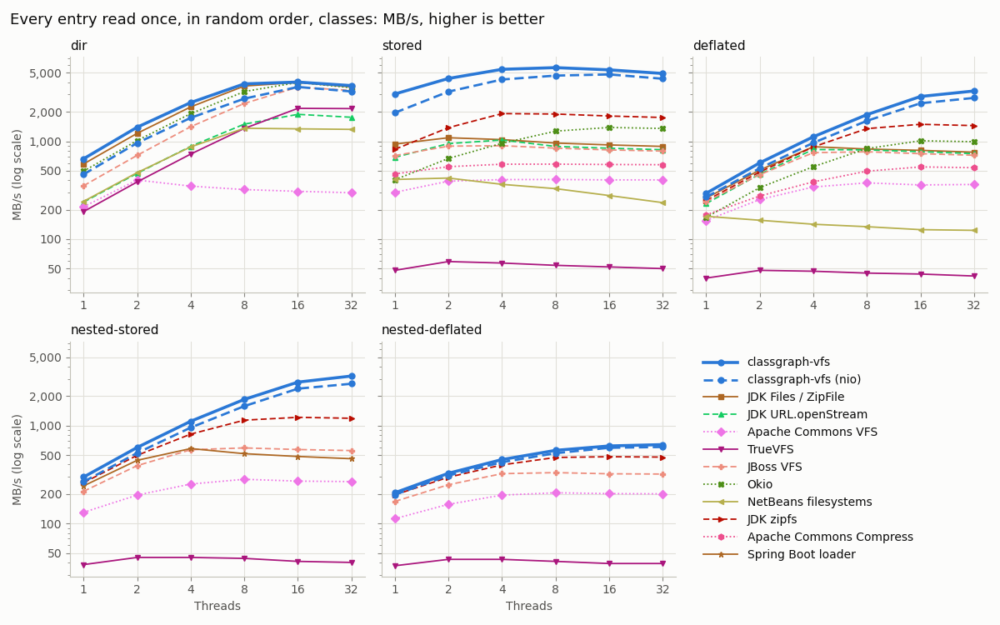
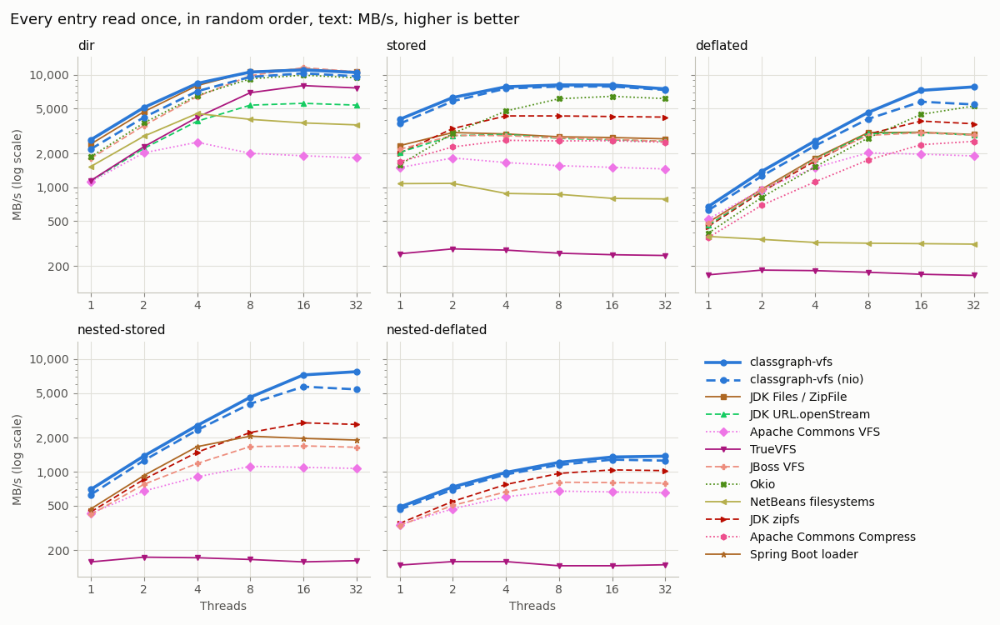
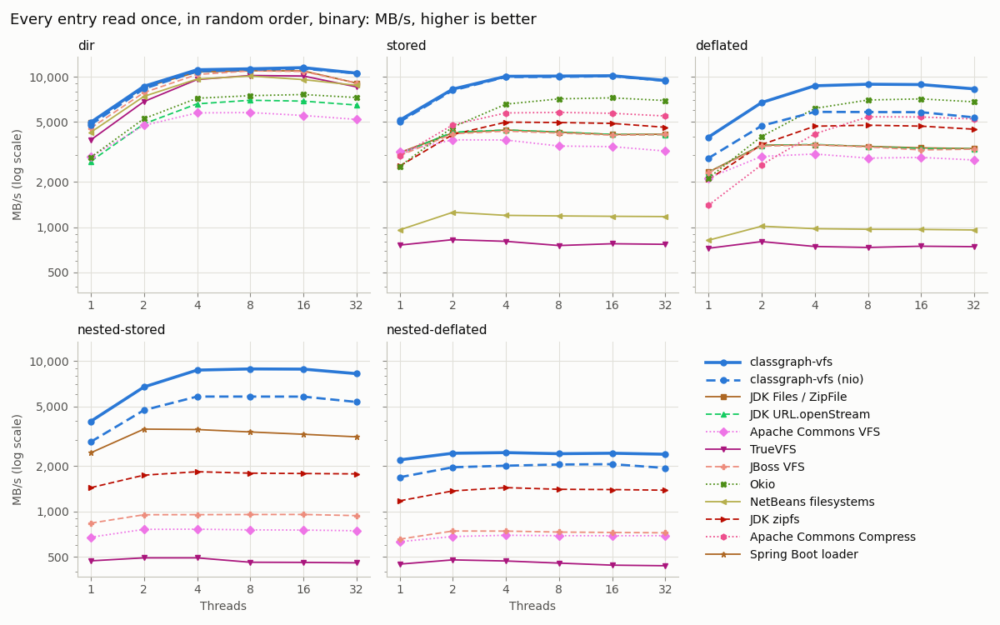
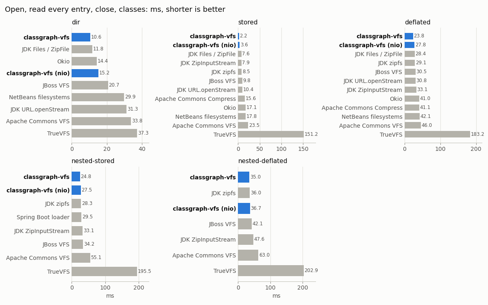
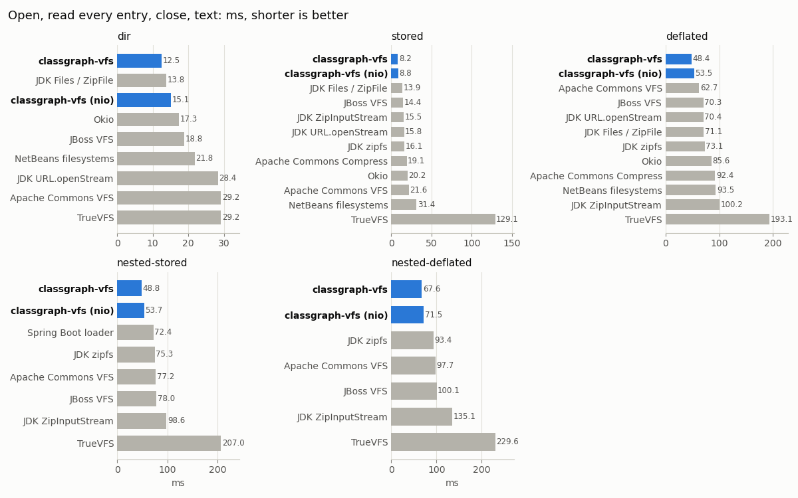
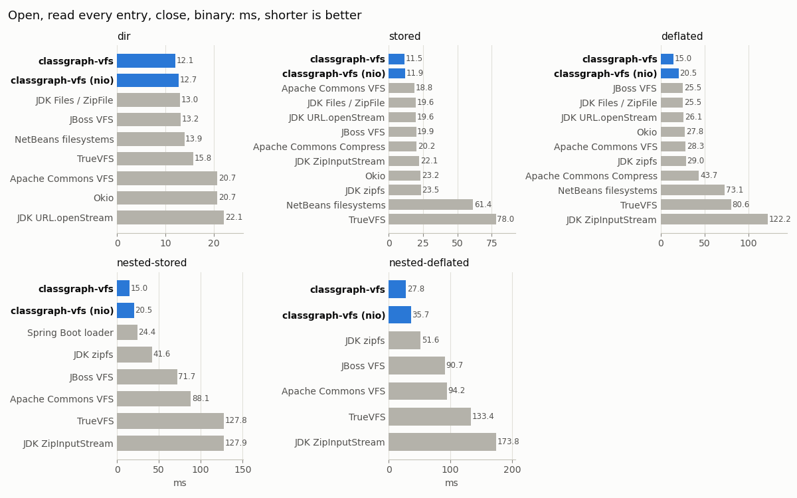
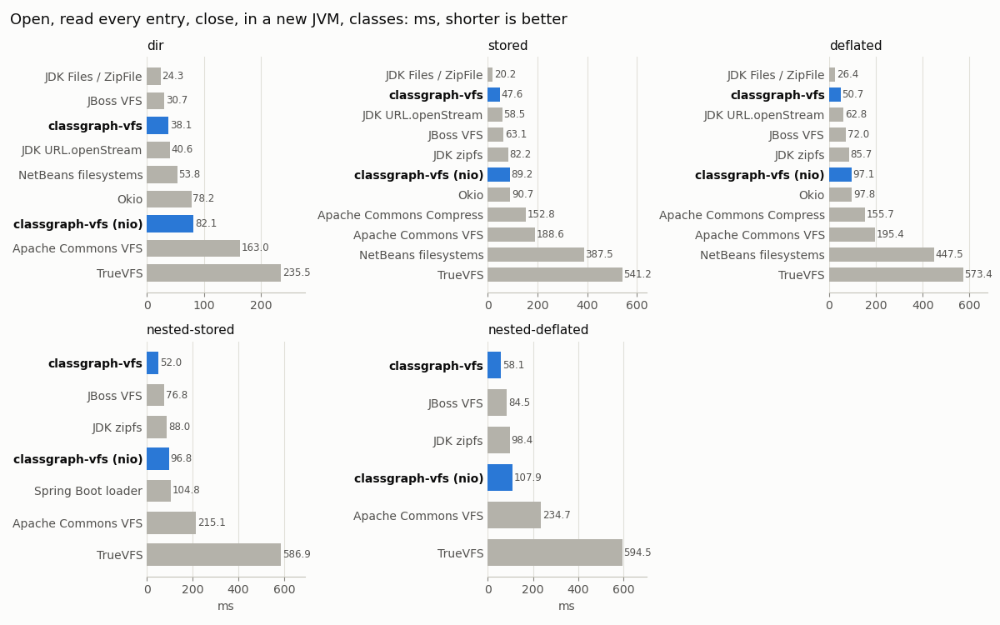
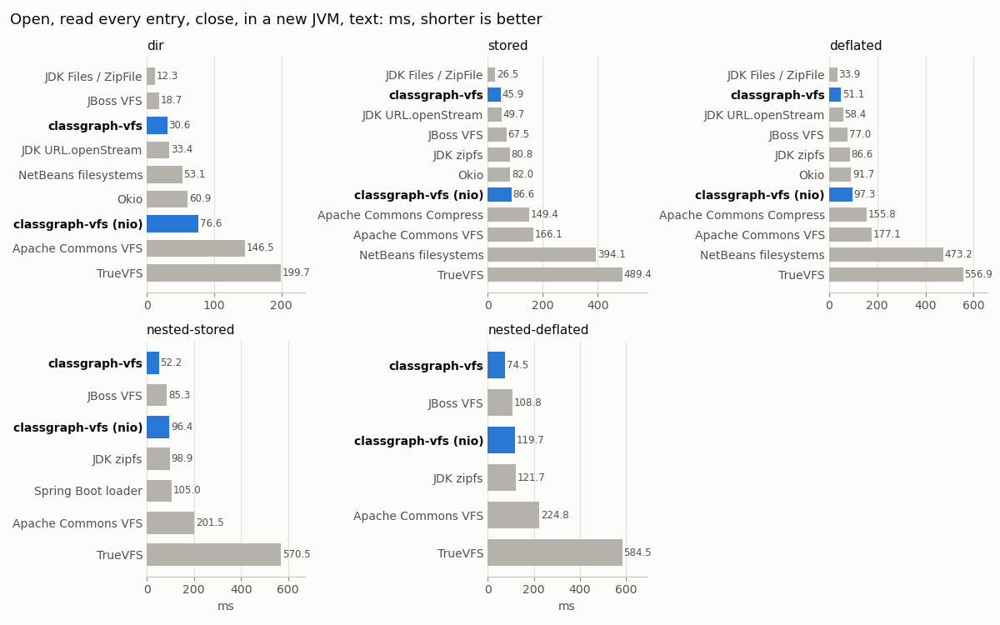
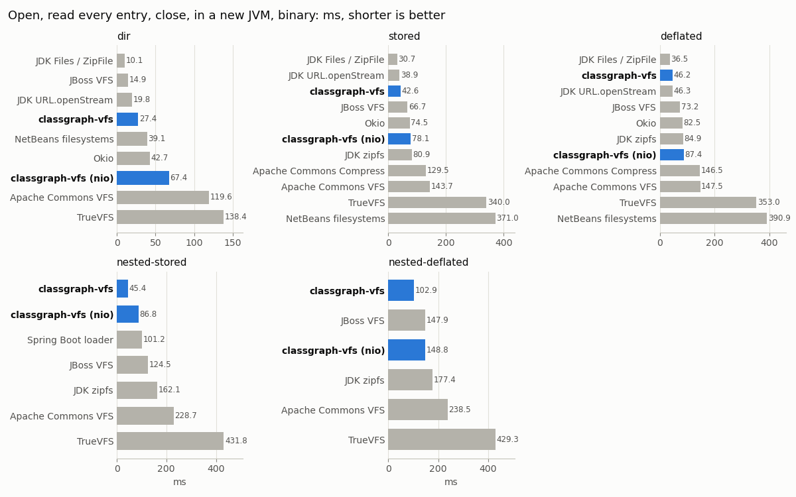

# classgraph-vfs (cgvfs)

A virtual filesystem: it reads directories, jarfiles and modules through one interface, however they
are named -- by path string, `File`, `Path`, `URI`, `URL`, `ModuleReference`, `InputStream` or byte
array -- and hands back the content of anything it finds as a stream, a channel, a `ByteBuffer`, a
byte array, a string, or a `java.nio.file.Path` in a read-only `FileSystem` view, so that
`java.nio.file.Files` can read a jarfile nested inside another jarfile. It has no scanner and no
classfile parser: if you want to find classes, use [`classgraph`](../classgraph) instead, which is
built on this library.

```xml
<dependency>
    <groupId>io.github.classgraph</groupId>
    <artifactId>classgraph-vfs</artifactId>
    <version>X.Y.Z</version>
</dependency>
```

Module name: `io.github.classgraph.vfs`. Requires JDK 25 or newer. No dependencies other than
`classgraph-base`, which is pulled in transitively.

Three classes carry the API: `Vfs` opens things, a `VfsRoot` is one opened directory, jarfile or
module, and a `VfsEntry` is one file within it. Three more turn up as you use them: `VfsSpec` holds
the settings a `Vfs` is constructed with, `CloseableByteBuffer` wraps a buffer you have to close,
and `VfsVisitor` is the callback that `VfsRoot#walk()` takes. Those six types are the API you call.
Two more are public only because `java.nio.file` needs them to be: `VfsFileSystemProvider`, which
`ServiceLoader` instantiates to serve the `cgvfs:` URL scheme, and `VfsPath`, the `Path` of a
filesystem view, whose one addition to `Path` is `toCgvfsUri()`. `Vfs` also has two public members
that are not part of the API, since they name types from packages that are not exported to every
module: a constructor that takes a type which, on the module path, only ClassGraph's own modules can
obtain, and `inflaterRecycler()`, which the virtual filesystem's internal packages read through. See
the [Vfs API](https://github.com/classgraph/classgraph/wiki/Vfs-API) for the full reference.

`VfsRoot` is sealed, with one public final subclass per kind of storage -- `DirRoot`, `ArchiveRoot`
and `ModuleRoot` -- so that a root can be switched on where the kind of storage matters. They add no
methods of their own: everything a root can do is declared on `VfsRoot`, and a subclass only
implements or overrides it.

A second package, `io.github.classgraph.vfs.reader`, holds the readers that the virtual filesystem
reads its own content through. They are exported because they are useful on their own: any content
that has to be read a value at a time, in a fixed byte order, and either at an offset
(`RandomAccessReader`) or from front to back (`SequentialReader`), can be read through them, from a
byte array, a `ByteBuffer`, a `FileChannel`, an `InputStream` or a `VfsEntry`. The byte order is a
property of the content rather than of the machine, so it is fixed when a reader is constructed and
never follows the machine's.

## One interface over every kind of storage

Java names a place to read from in at least seven ways, and reads from it in at least five. Which
of those a library accepts is usually an accident of what its author needed, so most code that
handles more than one kind of storage ends up with a branch per pairing. `Vfs` collapses that: every
way in produces the same `VfsRoot`, and every `VfsEntry` reads out in every way.

| Named by | Opened with |
| --- | --- |
| A path string, with `!/` separating nested jarfiles | `vfs.open("outer.jar!/lib/inner.jar")` |
| A `java.io.File` | `vfs.open(file)` |
| A `java.nio.file.Path`, in any filesystem | `vfs.open(path)` |
| A `java.net.URI` or `java.net.URL` | `vfs.open(uri)`, `vfs.open(url)` |
| A `java.lang.module.ModuleReference` | `vfs.open(moduleReference)` |
| A module name, in the boot layer or a given `ModuleLayer` | `vfs.openModule("java.logging")`, `vfs.openModule(name, layer)` |
| An `InputStream`, for a jarfile that is not on disk | `vfs.open(inputStream, "name.jar")` |
| A byte array holding a jarfile | `vfs.open(jarBytes, "name.jar")` |

| Read as | Method |
| --- | --- |
| `java.io.InputStream` | `entry.open()` |
| `java.nio.channels.ReadableByteChannel` | `entry.openChannel()` |
| `java.nio.ByteBuffer` (a memory mapping where possible), wrapped in a `CloseableByteBuffer` | `entry.read()` |
| `byte[]` | `entry.load()`, or `root.load(name)` |
| `String`, decoded as UTF-8 | `entry.loadAsString()` |
| `java.nio.file.Path`, in the filesystem view below | `entry.asPath()` |
| `java.nio.file.FileSystem`, over a whole root | `root.asFileSystem()` |

A root also names itself in every way it can: `getPath()`, `getURI()`, `getURL()`, `getFile()`,
`getNioPath()` and `getModuleReference()`, each returning null where the underlying storage has no
such name -- a module of the running JDK has no file, and a jarfile downloaded into RAM has no path.

A directory or jarfile is opened once however it is named, so the same root comes back for a plain
path, for the `file:` or `jar:` URL of the same thing, for a path that reaches it through a symlink,
and, on Windows, for a path written with backslashes rather than forward slashes, or one that names a
directory by its 8.3 short name. A root names itself at the canonical path, so `getPath()` is not
always the path you opened it by.

## What owns what

Ownership is a tree. The `Vfs` owns every root it opens; each root owns the storage behind it -- the
file handle, the memory mapping, and the temporary file that a nested jarfile has to be spilled to
when it cannot be read in place -- and the roots opened within it, which read through that storage.
Closing the `Vfs` closes every root, releasing all of it, and every root it handed out stops working
at that moment, so a `Vfs` belongs in a try-with-resources block, as it is in every example below.

Nothing outlasts that close, with the one exception below. A `CloseableByteBuffer` you have not
closed is closed for you as the root that handed it out closes, before the root releases the
storage the buffer was a view of, so a memory mapping is unmapped and a temporary file deleted as
the root closes rather than whenever the caller gets round to it. A stream from `entry.open()` that
you have not closed is closed for you at the same point, releasing the file handle it holds.
Reading a `ByteBuffer` you took out of such a wrapper after that point is a bug in the calling
code -- see [Read one entry](#read-one-entry). The one thing that can outlast the close is a mapping
that another thread is still using for an I/O operation as the close runs, such as a channel write
from a `ByteBuffer` taken out of such a wrapper: the JDK will not unmap a file while that operation
is in progress, so the file stays mapped until the JVM exits, and if it is a temporary file, it is
left behind.

A `VfsRoot` is `AutoCloseable` too, but rarely needs closing by hand, since closing the `Vfs` closes
it. Closing one early is for a long-lived `Vfs` that is done reading one root and wants what it
holds released now: `root.close()` releases the root's storage, closes the roots opened within it,
and takes it out of the `Vfs`'s cache, leaving the `Vfs` and every other root open. A root is
shared: a `Vfs` hands out the same root to everything that opens the same path, so two parts of a
program that open the same jarfile share one root, and closing it in one place closes it for the
other too. Short of that, nothing needs closing but
the `Vfs`:

```java
try (Vfs vfs = new Vfs()) {
    VfsRoot root = vfs.open("/path/to/library.jar");
    // ...
}
```

A `Vfs` can list what it has open: it is `Iterable<VfsRoot>`, just as a `VfsRoot` is
`Iterable<VfsEntry>`, and iterating it visits the roots that are currently open, sorted by path.
Each root is reported once, however many paths it was opened by, and a root that was read from a
stream or a byte array rather than opened from a path is not among them, since it is not cached.

A `Vfs` holds every root it has opened until it is closed, which matters only for a long-lived `Vfs`
that opens a great many of them. `vfs.evict(root)` drops one from the lookup cache, so the next
`vfs.open()` of the same path builds a new root. It does not close or release the evicted root:
the `Vfs` still tracks it for eventual cleanup, and anything holding it can continue reading.
To release a root's resources and remove its ownership registration now, close that root.

## Reading through `java.nio.file.Files`

`root.asFileSystem()` returns a read-only `FileSystem` over any root, so anything that takes a
`Path` can read a directory, a jarfile, a jarfile nested inside another jarfile, a package root, a
jarfile that exists only in RAM, or a module, without knowing which of those it has:

```java
try (Vfs vfs = new Vfs()) {
    VfsRoot root = vfs.open("/path/to/outer.jar!/BOOT-INF/lib/inner.jar");
    FileSystem fs = root.asFileSystem();
    byte[] classfile = Files.readAllBytes(fs.getPath("/com/xyz/Widget.class"));
    try (Stream<Path> paths = Files.walk(fs.getPath("/"))) {
        paths.filter(Files::isRegularFile).forEach(System.out::println);
    }
}
```

The JDK ships a zip filesystem provider, but it can only open a jarfile it can name as a `Path`. It
cannot open a module, and it cannot open a jarfile that was never written to disk. It also cannot
name a nested jarfile: given `jar:file:/path/to/outer.jar!/BOOT-INF/lib/inner.jar` it keeps only the
part before the first `!/`, and silently opens `outer.jar` instead, so the entries of `inner.jar`
are not there. Nesting can be reached by opening each level in turn and handing the inner `Path` to
the next, but that requires managing a filesystem for each level, and each level is read into memory
whether or not anything is read from it.

The separator is `/` and the root directory is `/`, whichever kind of root it is a view of. Files
are read with `Files.newInputStream`, `Files.newByteChannel`, `FileChannel.open`,
`Files.readAllBytes` and `Files.readString`; directories are listed with `Files.newDirectoryStream`, `Files.list` and
`Files.walk`. Native directory roots expose live directories, including empty ones, and native
attributes and symlink semantics. Archive and module directories are synthesized from entry names,
since their storage need not record every directory. Individual file lookups do not enumerate the
whole root. `getPathMatcher` supports both `glob:`
and `regex:`. `basic` is the only attribute view.

It is a read-only filesystem: everything that would write -- `Files.delete`, `Files.write`,
`Files.copy`, `Files.move`, `Files.createDirectory`, `Files.newOutputStream`, `setTimes`, and
`newByteChannel` with a write option -- throws `ReadOnlyFileSystemException`.

`root.asFileSystem()` returns the same view every time, until that view is closed. A filesystem is a
view of its root: `fs.close()` closes the view and its own streams, channels and directory streams, leaving
the root and the `Vfs` open and readable, and the next `root.asFileSystem()` hands out a fresh view.
Closing the root, or the `Vfs` that opened it, closes every view of it in the same one-way manner --
`isOpen()` returns false, every read through the filesystem throws `ClosedFileSystemException` as
`java.nio.file.FileSystem` specifies, and `asFileSystem()` and `entry.asPath()` throw
`ClosedFileSystemException`, since there is nothing left to hand out a view of. Closing a borrowed
view does not release the root's shared backing storage, mappings or temporary files; close the
root or the `Vfs` to release those.

A view can itself be wrapped: `wrapper.open(root.asFileSystem().getPath("/"))` opens a directory
backed by that filesystem, and its resulting view can be wrapped again. The source filesystem is
borrowed and must remain open while the wrapper is used. Closing the wrapper does not close the
source. Cache identity includes the filesystem instance, so separate views remain independent
even if their paths have the same URI.

The one exception is a filesystem that `FileSystems.newFileSystem` created, for a `cgvfs:` URI or
for a directory: it created the `Vfs` behind it, and is the only reference you have to it, so
closing that filesystem closes that `Vfs` too.

## The `cgvfs:` URL scheme

`classgraph-vfs` registers a `java.nio.file.spi.FileSystemProvider` for the `cgvfs:` scheme, so
anything that can name a filesystem by URI can name one of these. Registration happens through
`ServiceLoader`, so putting the jar on the classpath or the module path is all that is needed:

```java
try (FileSystem fs = FileSystems.newFileSystem(
        URI.create("cgvfs:/path/to/outer.jar!/BOOT-INF/lib/inner.jar"), Map.of())) {
    byte[] classfile = Files.readAllBytes(fs.getPath("/com/xyz/Widget.class"));
}
```

Everything after `cgvfs:` is a path in the syntax `Vfs.open(String)` takes, so all of these work:

| URI | Names |
| --- | --- |
| `cgvfs:/path/to/app.jar` | a jarfile |
| `cgvfs:file:/path/to/app.jar` | the same jarfile -- the inner scheme is optional |
| `cgvfs:/path/to/classes` | a directory |
| `cgvfs:/path/to/outer.jar!/lib/inner.jar` | a jarfile nested inside another jarfile |
| `cgvfs:/path/to/app.jar!/BOOT-INF/classes` | a package root within a jarfile |
| `cgvfs:jrt:/java.logging` | a module of the boot layer |
| `cgvfs:https://example.com/app.jar` | a jarfile at a URL |

Which of `newFileSystem` and `getPath` you call decides whether the last `!/` section is opened as a
filesystem of its own or read as a path within the enclosing one, the same way a `jar:` URI works
for zipfs. `FileSystems.newFileSystem(uri, env)` opens the whole path as a filesystem;
`Paths.get(uri)` reads the last `!/` section against the longest prefix that already has a
filesystem open, so with the filesystem above open, `cgvfs:/path/to/outer.jar!/lib/inner.jar!/com/xyz/Widget.class`
is a path *inside* `inner.jar`, not inside `outer.jar`.

One filesystem is open at a URI at a time: a second `FileSystems.newFileSystem(uri, env)` for the
same path throws `FileSystemAlreadyExistsException`, without opening anything, until the first is
closed, and `FileSystems.getFileSystem(uri)` finds the open one or throws
`FileSystemNotFoundException`. A filesystem created this way owns the `Vfs` behind it, so closing it
releases everything that `Vfs` took.

Installing the scheme changes one thing outside it. `FileSystems.newFileSystem(path)` tries each
installed provider in turn and takes the first that does not decline the path, in an order that is
not defined: with `classgraph-vfs` on the module path, this provider is tried before the JDK's
zipfs. So this provider accepts only a *directory*, which no built-in provider reads as a
filesystem, and declines every other path with `UnsupportedOperationException` so that the search
carries on. A jarfile still goes to zipfs, and so does a path where `Map.of("create", "true")` asks
zipfs to create a zipfile. A directory gets a `cgvfs:` filesystem where that call would otherwise
throw `ProviderNotFoundException`. Each such call returns a new filesystem, which owns the `Vfs` it
opened and, as with zipfs, is not registered under its path: `FileSystems.getFileSystem(uri)` and
`Paths.get(uri)` do not find it, and it does not stop a later `newFileSystem` at the same directory,
by path or by URI. To open an archive through this provider, call
`vfs.open(path).asFileSystem()`, or name it with a `cgvfs:` URI.

Two options can be passed in the `env` map: `"vfsSpec"`, a `VfsSpec` configuring the `Vfs` that will
be created (see [Options](#options)), and `"layer"`, a `ModuleLayer` to resolve a `cgvfs:jrt:/...`
module name against instead of the boot layer. Only one module of a given name can be open through
`newFileSystem` at a time, whatever its layer; to read two at once, open each with
`vfs.openModule(name, layer).asFileSystem()`.

`VfsPath.toCgvfsUri()` writes a path back out as a `cgvfs:` URI, and throws
`FileSystemNotFoundException` if the scheme is not installed in this JVM, rather than handing back a
URI that nothing could resolve. (`ServiceLoader` only finds the provider if `classgraph-vfs` is
loaded by the system class loader, so the scheme is silently absent inside a servlet container, a
Spring Boot fat jar or an OSGi bundle, which load it in a child loader.) `Path.toUri()` is
unchanged, and still returns the `file:`, `jar:` or `jrt:` URI of the underlying storage, which
names the same bytes to code that has never heard of ClassGraph.

## What it reads that `java.util.zip` does not

* **Jarfiles nested inside other jarfiles, to any depth**, named by separating the levels with
  `!/`, e.g. `outer.jar!/lib/inner.jar!/lib/innermost.jar`. A nested jarfile that is stored
  uncompressed is read in place, with no copy; one that is stored deflated is inflated into RAM,
  or spilled to a temporary file if it exceeds the maximum buffered jar RAM size (64MB by default).
* **A package root within a jarfile**, named by a trailing `!/` section that is not itself a
  jarfile, e.g. `spring-boot-app.jar!/BOOT-INF/classes`. Entry names are reported with the root
  stripped off.
* **Multi-release jarfiles**, resolved to the newest version of each entry that the running JVM can
  use, or every version if multi-release versions were disabled on the `VfsSpec`.
* **Jarfiles at a URL**, for any scheme the JVM has a handler for, unless that scheme was denied on
  the `VfsSpec`. The file is downloaded in full first, because a zipfile's central directory is at
  the end. A scheme with a `FileSystemProvider` installed for it is read in place instead, with no
  copy. See [Custom URL schemes](#custom-url-schemes).
* **Entry names encoded in IBM Code Page 437**, which the zip specification requires when bit 11 of
  the entry's general purpose bit flag is clear. Windows Explorer and Info-ZIP both write such
  names.

## Options

How storage is read is set by a `VfsSpec`, which the `Vfs` constructor takes. Each setting is
changed by a method that returns the same `VfsSpec`, so the ones that differ from the default can be
chained onto the constructor call and the rest left alone:

```java
new Vfs(new VfsSpec().denyURLScheme("https").setMaxBufferedJarRAMSize(65536))
```

| Setting | Default | Effect |
| --- | --- | --- |
| `enableNestedJars()` / `disableNestedJars()` | enabled | Whether `!/` in a path may name a jarfile within a jarfile, rather than only a package root within a jarfile |
| `enableMultiReleaseVersions()` / `disableMultiReleaseVersions()` | enabled | Whether to serve each entry of a multi-release jarfile in the highest version that does not exceed this JVM's major version, as the JVM does, rather than reporting every version under its own `META-INF/versions/<N>/` path |
| `denyURLScheme(String)` / `allowURLScheme(String)` | none denied | A URL scheme a jarfile may **not** be opened from, e.g. `"https"`. Every scheme the JVM has a handler for is allowed until it is denied. Denying `file:` or `jar:` has no effect, since both prefixes are stripped before a path is opened. Call once per scheme |
| `setMaxBufferedJarRAMSize(int)` | 64MB | How many bytes of a jarfile may be held in RAM before it is spilled to a temporary file |
| `setOpenWaitTimeout(Duration)` | zero (wait indefinitely) | How long a thread opening a path waits for another thread that is already opening the same directory or jarfile, counting only time in which no thread reading through the `Vfs` made progress. When the wait times out, the waiting `open` throws `IOException`. `ClassGraph` sets this to its worker timeout |

`new Vfs()` uses the default of every setting. Each setting has a matching getter --
`isNestedJarsEnabled()`, `isMultiReleaseVersionsEnabled()`, `getDeniedURLSchemes()`,
`getMaxBufferedJarRAMSize()` and `getOpenWaitTimeout()` -- and `VfsSpec.DEFAULT_ENABLE_NESTED_JARS`,
`VfsSpec.DEFAULT_ENABLE_MULTI_RELEASE_VERSIONS` and `VfsSpec.DEFAULT_MAX_BUFFERED_JAR_RAM_SIZE` name
the defaults.

The `Vfs` constructor copies the `VfsSpec`, so everything one `Vfs` opens is read with the same
settings. Changing a setting of your `VfsSpec` afterward only affects a `Vfs` constructed from it
afterward. `vfs.getVfsSpec()` returns the copy, which cannot be changed: each of its setters throws
`IllegalStateException`. A setting of your own `VfsSpec` is safe to change from any thread, since
every setting is held in a volatile field.

## Custom URL schemes

A path handed to `vfs.open(String)` that starts with a URL scheme is opened as a URL, and a `Vfs`
opens whatever the JVM can open. There is nothing to register with `classgraph-vfs`: a scheme is
openable because the JDK ships a handler for it, or because the application registered one through
one of the two JDK service provider interfaces below.

| Registered as | Registered by | How `classgraph-vfs` reads it |
| --- | --- | --- |
| `java.net.URLStreamHandler` | `URL.setURLStreamHandlerFactory(factory)`, a `java.net.spi.URLStreamHandlerProvider` on the module path or in `META-INF/services`, or the `java.protocol.handler.pkgs` system property | The jarfile is downloaded in full through the handler's `URLConnection`, into RAM or a temporary file |
| `java.nio.file.spi.FileSystemProvider` | A provider on the module path or in `META-INF/services` | `Path.of(uri)` resolves through the provider and the jarfile is read in place, with no copy |

A `FileSystemProvider` wins where both are registered for a scheme: reading in place beats
downloading. It is tried first, and a `FileSystemNotFoundException` from it is what falls back to
the download. The two exceptions are `http` and `https`, which are always downloaded, since a URL at
either is remote by definition.

The JDK ships handlers for `file`, `jar`, `http`, `https`, `ftp`, `mailto`, `jrt` and `jmod`
(measured on JDK 17 and JDK 26), and installed `FileSystemProvider`s for `file`, `jar` and `jrt`.
So opening `s3://bucket/lib.jar` works exactly when something in the application has registered an
`s3` handler or filesystem provider, and fails with the JVM's own report otherwise:

```
java.io.IOException: Could not open s3://bucket/lib.jar :
    java.io.IOException: Could not parse URL (java.net.MalformedURLException: unknown protocol: s3): s3://bucket/lib.jar
```

To keep a jarfile from being fetched over a scheme, name it:

```java
new Vfs(new VfsSpec().denyURLScheme("https"))
```

A `Vfs` denies nothing by default. `ClassGraph` and `ClasspathFinder` construct theirs with `http`,
`https`, `ftp` and `mailto` denied, because a classpath is not always something the caller wrote,
and the handlers for those four connect over a network on any JVM (`mailto` connects to a mail
server, though it cannot fetch a jarfile). `allowURLScheme(String)` takes a scheme back off
that list.

An `http` or `https` redirect is followed, including one from `http` to `https`, up to 20 times.
A redirect to any other scheme, from `https` to `http`, or to a denied scheme is refused, so
allowing `http` alone does not let a server redirect the download to `https`.

The list is a deny list rather than an allow list because there is no way to build the allow list:
the JDK offers no way to enumerate the registered schemes. `URL`'s handler table is private, and
`setAccessible` on it throws `InaccessibleObjectException` on JDK 17 and later, since `java.base`
does not open `java.net`; `ServiceLoader<URLStreamHandlerProvider>` sees only the providers declared
in service files, so it misses every handler installed by `URL.setURLStreamHandlerFactory`; and the
`URLConnection` a handler returns does not say who registered it, because a custom handler that
delegates to `file:` returns the JDK's own `sun.net.www.protocol.file.FileURLConnection`. Requiring
each scheme to be allowed would therefore have meant every application that installs a handler also
naming it here, to no benefit -- installing the handler is already the statement that those URLs are
meant to be read.

To sidestep URL handling altogether, open a `Path` instead: `vfs.open(Path)` reads through whatever
filesystem the `Path` belongs to, and never looks at a scheme.

```java
try (FileSystem fs = FileSystems.newFileSystem(URI.create("s3://bucket"), Map.of());
        Vfs vfs = new Vfs()) {
    VfsRoot root = vfs.open(fs.getPath("/lib/library.jar"));
    System.out.println(root.getEntries().size() + " entries");
}
```

## Concurrency

`java.util.zip.ZipFile` serializes on the instance monitor: every public method takes
`synchronized (this)` -- `getEntry`, `getInputStream`, `entries`, `stream`, `size`, `close` -- and
`ZipFileInputStream.read` takes it on every read call. One level down, `Source.readFullyAt` and
`Source.readAt` take `synchronized` on a `RandomAccessFile` that is *shared between separate
`ZipFile` instances opened on the same file*, because `Source` instances are cached and reference
counted by file. The locking is unavoidable there: a `RandomAccessFile` has one cursor, so the
seek and the read have to be atomic with respect to each other.

`classgraph-vfs` never has a cursor to protect. Every read names the absolute offset it wants: a
file is read either through a memory-mapped `ByteBuffer`, which is indexed absolutely, or through
`FileChannel#read(ByteBuffer, long)`, which takes the position as an argument rather than carrying
one, and which reaches `pread` without taking the channel's position lock. The central directory is
parsed once into an immutable index. So entry lookup and entry reads take no locks at all.

(Which of the two is used is a speed choice, not a correctness one. A jarfile is memory-mapped, and
a read from it goes through the mapping if it is small and through `FileChannel#read` if it is
large: a read through the mapping costs a page fault for each page it touches the first time, and a
read through a channel costs a system call, so the mapping is faster for a read of under about 32KB
on Linux, and the channel for a larger one. A file in a directory is read through a channel. See the
[memory mapping benchmark](https://github.com/classgraph/classgraph/wiki/Memory-Mapping-Benchmark).
A mapped file is unmapped when the root that mapped it is closed, which closing the `Vfs` does to
every root, by closing the `java.lang.foreign.Arena` that mapped it. The root closes every
`CloseableByteBuffer` it handed out first, so that no wrapper is left holding a view of a mapping the
root is about to release, and the unmap is the last thing the close does. Unmapping has to happen as
the root closes because Windows refuses to overwrite a file while it is mapped, and some versions of
Windows refuse to delete one: a close that returned with the files it had mapped still mapped would
leave them locked, and on those versions a temporary file that a nested jarfile had been extracted
to could not be deleted.)

A `Vfs` and everything it hands out is safe to use from many threads at once. This is what lets
ClassGraph scan a jarfile in parallel. What that is worth is measured in
[Benchmarks](#benchmarks) below.

## Compared with other libraries

The libraries compared are the ways the JDK itself offers to read a jarfile, and the other virtual
filesystem and zip libraries for the JVM that are still in use:

| Library | Version | License | Minimum JDK | Latest release |
| --- | --- | --- | --- | --- |
| **classgraph-vfs** | 6.0.1 | MIT | 25 (17 for 5.x) | 2026-10 |
| JDK zip filesystem provider (zipfs) | JDK 26.0.2 | GPLv2 + Classpath Exception | -- | -- |
| `java.util.zip.ZipFile` / `java.util.jar.JarFile` | JDK 26.0.2 | GPLv2 + Classpath Exception | -- | -- |
| `java.util.zip.ZipInputStream` | JDK 26.0.2 | GPLv2 + Classpath Exception | -- | -- |
| `java.net.URL` (`file:`, `jar:`, `http:`, `jrt:`) | JDK 26.0.2 | GPLv2 + Classpath Exception | -- | -- |
| [Apache Commons VFS](https://commons.apache.org/proper/commons-vfs/) | 2.10.0 | Apache-2.0 | 8 | 2025-02 |
| [TrueVFS](https://github.com/christian-schlichtherle/truevfs) | 0.14.0 | Apache-2.0 | 8 | 2021-01 |
| [JBoss VFS](https://github.com/jbossas/jboss-vfs) | 3.3.2.Final | Apache-2.0 | 11 | 2024-04 |
| [Okio](https://square.github.io/okio/) `ZipFileSystem` | 3.18.2 | Apache-2.0 | 8 | 2026-09 |
| [Spring Boot loader](https://docs.spring.io/spring-boot/specification/executable-jar/) `NestedJarFile` | 4.1.2 | Apache-2.0 | 17 | 2026-10 |
| [Apache Commons Compress](https://commons.apache.org/proper/commons-compress/) `ZipFile` | 1.28.0 | Apache-2.0 | 8 | 2025-07 |
| [NetBeans filesystems API](https://bits.netbeans.org/dev/javadoc/org-openide-filesystems/) | RELEASE310 | Apache-2.0 | 17 | 2026-08 |

Apache Hadoop's `FileSystem` and Eclipse's EFS are also virtual filesystems, but each is built for
one platform (HDFS-style storage, and the Eclipse workspace), and neither reads entries from inside a
jarfile, so they are left out.

### Features

Every cell below was tested on JDK 26.0.2 against small fixtures, by a probe that reads a known
entry and checks its content, except the rows marked *documented*, which come from each library's
own documentation.

* ✅ -- works.
* **opt** -- works only when an option is passed (named in the notes below the table); without it,
  the result is wrong.
* **wrong** -- returns a result, but the wrong one.
* ❌ -- fails with an exception.
* -- -- the library has no API for it.
* ? -- not tested.

| Feature | **cgvfs** | zipfs | `ZipFile` | `ZipInputStream` | `URL` | Commons VFS | TrueVFS | JBoss VFS | Okio | Spring Boot | Commons Compress | NetBeans |
| --- | :-: | :-: | :-: | :-: | :-: | :-: | :-: | :-: | :-: | :-: | :-: | :-: |
| Directory | ✅ | -- | -- | -- | ✅ | ✅ | ✅ | ✅ | ✅ | -- | -- | ✅ |
| Jarfile | ✅ | ✅ | ✅ | ✅ | ✅ | ✅ | ✅ | ✅ | ✅ | -- | ✅ | ✅ |
| Nested jarfile, stored | ✅ | ✅ | -- | -- | ❌ | ✅ | ✅ | ✅ | ❌ | ✅ | -- | ❌ |
| Nested jarfile, deflated | ✅ | ✅ | -- | streaming only | ❌ | ✅ | ✅ | ✅ | ❌ | ❌ | -- | ❌ |
| Nested three deep | ✅ | ✅ | -- | ? | ❌ | ✅ | ✅ | ? | ❌ | ? | -- | ❌ |
| Temporary files written to read a deflated nested jarfile | 0 | 0 | -- | 0 | -- | 1 | 2 | 1 | -- | -- | -- | -- |
| Jarfile held in a `byte[]` | ✅ | -- | -- | ✅ | -- | ✅ | -- | ✅ | -- | -- | ✅ | -- |
| Jarfile at an `http:` URL | ✅ | -- | -- | ✅ | ✅ | ✅ | ✅ | -- | -- | -- | -- | -- |
| Jarfile in another `java.nio` filesystem (Jimfs) | ✅ | ✅ | -- | -- | -- | ? | ❌ | -- | -- | -- | ✅ | -- |
| Module in the JDK's runtime image (`jrt:`) | ✅ | -- | -- | -- | ✅ | -- | -- | -- | -- | -- | -- | -- |
| Multi-release jarfile, newest version for the running JVM | ✅ | opt | opt | -- | opt | wrong | wrong | wrong | wrong | ✅ | ? | wrong |
| Entry names in IBM Code Page 437 | ✅ | opt | opt | opt | ? | opt | ✅ | ? | wrong | ? | opt | ❌ |
| ZIP64, 70000 entries | ✅ | ✅ | ✅ | ✅ | ? | ✅ | ✅ | ✅ | ✅ | ✅ | ✅ | ✅ |
| Is a `java.nio.file.FileSystem` | ✅ | ✅ | -- | -- | -- | -- | ✅ | -- | -- | ✅ | -- | -- |
| `Files.walk` over it | ✅ | ✅ | -- | -- | -- | -- | ❌ | -- | -- | ? | -- | -- |
| Nested jarfile as a `FileSystem`, by URI | ✅ | ✅ | -- | -- | -- | -- | ? | -- | -- | ✅ | -- | -- |
| Seek within a deflated entry | ✅ | ✅ | -- | -- | -- | ❌ | ✅ | ? | ? | ? | ? | ? |
| 16 threads reading one entry 2000 times each | ✅ | ✅ | ✅ | -- | ✅ | see below | ✅ | ✅ | ✅ | ✅ | ✅ | see below |
| Jarfile truncated while open, stored entry | ✅ | wrong | wrong | wrong | wrong | wrong | ✅ | wrong | ✅ | ? | wrong | ✅ |
| Jarfile truncated while open, deflated entry | ✅ | ✅ | ✅ | ✅ | ✅ | ✅ | ✅ | ✅ | ✅ | ✅ | ✅ | ✅ |
| Memory-maps the jarfile | yes | no | no | no | no | no | no | no | no | no | no | no |
| Open to JDK mapped-file bug 1: JVM crash on aarch64 when the jarfile is truncated or its storage fails | no (worked around) | no | no | no | no | no | no | no | no | no | no | no |
| Open to JDK mapped-file bug 2: wrong bytes returned, and an `InternalError` thrown later, in the same case | no (worked around) | no | no | no | no | no | no | no | no | no | no | no |
| Open to JDK mapped-file bug 3: JVM crash on x86-64 in the same case | no (worked around) | no | no | no | no | no | no | no | no | no | no | no |
| Write | -- | ✅ | -- | -- | -- | ❌ | ✅ | -- | -- | -- | -- | directories only |
| Other storage (*documented*) | any URL scheme with a JDK handler or `FileSystemProvider` | -- | -- | any `InputStream` | any URL scheme with a JDK handler | ftp, ftps, sftp, http(s), webdav, hdfs, ram, tar, gz, bz2 and more | tar, tar.gz, tar.bz2, tar.xz, odf, zip-raes | -- | -- | -- | 7z, tar, ar, arj, cpio, dump (as archives, not filesystems) | -- |
| Change notification (*documented*) | -- | -- | -- | -- | -- | `DefaultFileMonitor` | -- | -- | -- | -- | -- | `FileChangeListener` |

Notes:

* **The options.** zipfs reads a multi-release jarfile's versions only when opened with
  `releaseVersion` set (e.g. to `"runtime"`), and `ZipFile` only through
  `new JarFile(file, true, OPEN_READ, Runtime.version())`; a `jar:` URL needs `#runtime` appended.
  Without the option, all three return the base version. A CP437 entry name decodes correctly only
  when `IBM437` is passed as the charset (zipfs `encoding`, the `ZipFile`, `ZipInputStream` and
  Commons Compress constructors, and a Commons VFS file system option); otherwise it is decoded as
  UTF-8 and comes back garbled. cgvfs and TrueVFS do both without being asked: the zip
  specification says whether each entry's name is UTF-8 or CP437, by bit 11 of its general purpose
  flags, so no option is needed.
* **The failures.** `URL` rejects every nested jarfile, with `MalformedURLException: Nested JAR URLs
  are not supported`; NetBeans fails the same way, from inside its own code. Okio throws
  `UnsupportedOperationException: not implemented yet!` on a nested jarfile. Spring Boot's
  `NestedJarFile` requires a nested jarfile to be stored, which its own build tooling guarantees.
  TrueVFS fails to find a jarfile in a Jimfs filesystem, and `Files.walk` over a TrueVFS path throws
  `UnsupportedOperationException: Not supported yet.` Commons VFS cannot seek within a deflated
  entry (`FileSystemException: The file type does not support read in random access mode.`), and
  cannot write into a zipfile. NetBeans reads a CP437 jarfile as empty.
* **"wrong" for multi-release** means the library returned the base version of the entry where the
  JVM would have loaded the version for its own release.
* **Commons VFS under concurrency.** Reading one entry through one `FileObject` from 16 threads
  works, but reading different entries does not, in the default configuration. When a `FileObject`
  in a zipfile is detached, `ZipFileObject.doDetach` closes the whole zip file system, including the
  `ZipFile` every other thread is reading from, if no stream on it is open at that moment. The check
  and the close are not atomic, so other threads' reads fail. A `FileObject` is detached when it is
  closed, when an `LRUFilesCache` evicts it, and -- under the default cache strategy,
  `CacheStrategy.ON_RESOLVE` -- every time it is resolved. Resolving the path on each read, with
  `manager.resolveFile(uri).getContent()`, failed 0 of 32000 reads on one thread, 64 on two threads,
  and between 179 and 264 on 16, with `ZipException: ZipFile closed` and
  `IllegalStateException: zip file closed`. Resolving each entry against a root `FileObject` that
  stays open failed the same way. The benchmarks below use `CacheStrategy.MANUAL`, which never
  refreshes on resolve, and never close an entry's `FileObject`.
* **NetBeans under concurrency.** `JarFileSystem` (RELEASE310 and the current master) reads an
  entry of up to 100000 bytes into RAM, which works from any number of threads. It copies a larger
  entry to a temporary file, under `jarfscache<user.name>` in `java.io.tmpdir`, and returns a
  stream that reads that file. The file's name depends only on the hash codes of the jarfile path
  and the entry name, so every read of the same entry uses the same file. The copy is made under a
  lock, but while any `FileObject` of the filesystem is alive (which is whenever an entry is being
  read), every read makes the copy again, truncating the file first, and the streams returned to
  earlier reads are read after the lock is released. A stream therefore reads whatever part of the
  file has been rewritten so far. Reading random 1MB entries with `FileObject.asBytes()` failed 0
  of 500 reads on one thread, 21 to 39 of 1000 on two, and about 250 of 8000 on 16, from both stored
  and deflated jarfiles, with `IOException: Just 479232 bytes read from bin/07.bin` and the like
  (`asBytes()` checks the length; `getInputStream()` returns the short content without an error).
  The same file is also shared by two `JarFileSystem`s on one jarfile, by two JVMs of one user, and
  by two jarfiles whose paths have the same hash code, such as `Aa.jar` and `BB.jar` in one
  directory: a stream opened on `Aa.jar` then returns the entry of `BB.jar`. Reported as
  [apache/netbeans#9761](https://github.com/apache/netbeans/issues/9761), with a fix in
  [apache/netbeans#9762](https://github.com/apache/netbeans/pull/9762), which gives every read its
  own temporary file, deleted when its stream is closed. The NetBeans benchmarks below were run with
  that fix.
* **Temporary files.** TrueVFS, Commons VFS and JBoss VFS extract a deflated nested jarfile to a
  temporary file before reading it (Commons VFS into `vfs_cache` under `java.io.tmpdir`). cgvfs
  inflates it into RAM, and spills it to a temporary file only above 64MB, a limit set by
  `VfsSpec.setMaxBufferedJarRAMSize`. zipfs wrote no temporary file either. NetBeans writes one for
  every entry over 100000 bytes, even in a jarfile that is not nested (see above).
* **A jarfile truncated while it is open.** Each library read every entry of a 32MB jarfile five
  times, the jarfile was truncated to 4096 bytes, and every entry was read again, on Linux x86-64,
  JDK 25 and 26. Here ✅ means the library either threw an exception or returned the right content
  (TrueVFS, and cgvfs for a deflated nested jarfile, which both hold the content in RAM), and
  **wrong** means it returned short content with no error. `ZipFile`, `URL`, Commons VFS and JBoss VFS
  (which all read through `ZipFile`) and zipfs return the first entry cut off at the new end of the
  file, and throw on the next one. Commons Compress returns every entry short, and the entries that
  now start past the end of the file as empty. `ZipInputStream` ends the archive early: its next
  `getNextEntry()` returns null. Spring Boot was tested only on a stored nested jarfile, whose entries
  are deflated.
* **The JVM bugs.** Reading a memory-mapped file after it has been truncated, or after its storage
  has failed (a network share that went away, a disk that was detached), meets three JDK bugs: (1) on
  aarch64, a compiled bulk copy of more than 80 bytes kills the JVM with `SIGBUS`; (2) a compiled read
  returns bytes that are not in the file and throws its `InternalError` later, outside the read (see
  [JDK-8154592](https://bugs.openjdk.org/browse/JDK-8154592)); and (3) on x86-64, C2 can box such a
  byte through an index it does not check, and the JVM dies with `SIGSEGV`. cgvfs maps a jarfile, and
  works around all three on JDK 25 and later, as its tests check in CI on Linux (x86-64 and aarch64)
  and macOS (aarch64); Windows does not let a mapped file be truncated. None of the
  other libraries maps the jarfile, so none of them can meet these bugs: no class in their jars, nor
  in the JDK's `java.util.zip`, `java.util.jar` and zipfs code (JDK 17, 25 and 26), calls
  `FileChannel.map` or uses a `MemorySegment`. On Linux x86-64, no file other than the JDK's own was
  mapped while each library read every entry of a jarfile of each layout. They read with
  `RandomAccessFile` or `FileChannel`, where the same failure is an `IOException`, or a short read.
* **Writing** is the one thing cgvfs does not do: it is read-only by design. A caller that has to
  modify a jarfile in place needs zipfs or TrueVFS.

## Benchmarks

Every library in the [comparison above](#compared-with-other-libraries) that can read an entry by
name is measured on the same work, with [JMH](https://github.com/openjdk/jmh) 1.37. The benchmarks
are in [`src/test/perf`](src/test/perf/io/github/classgraph/vfs/perf):
[`RunBenchmarks`](src/test/perf/io/github/classgraph/vfs/perf/RunBenchmarks.java) generates the
archives, runs everything, and writes a table of the results, which
[`plot_benchmarks.py`](src/test/perf/plot_benchmarks.py) draws as the charts below; its Javadoc gives
the command.

Three kinds of content, each in five layouts:

* **Content.** *Classfiles*: 2000 classfiles from across `java.base` (7MB), small entries that
  deflate to about half their size, which is what a classpath scan reads. *Text*: 1424 entries of
  pseudo-English text from 512 bytes to 128KB (34MB), which deflates to about a third. *Binary*:
  320 entries of pseudo-random bytes from 4KB to 1MB (61MB), which do not compress. The sizes of
  the text and binary entries are spread evenly on a log scale, so that half of the bytes are in
  entries of under 66KB and 530KB respectively. In the jarfiles of a Maven repository, half of the
  bytes of text resources are in entries of under 67KB, and of binary resources under 2.8MB: the
  binary entries here are smaller than that, so that there are enough of them for 32 threads to
  share evenly, and so that the deflated nested jarfile still fits in the memory `Vfs` buffers a
  nested jarfile in by default.
* **Layout.** A directory; a jarfile with its entries stored; a jarfile with its entries deflated;
  and that deflated jarfile nested inside an outer jarfile, either stored or deflated there.

Three benchmarks:

* **First reads.** The archive is opened, every entry is looked up by name and read in full exactly
  once, in a shuffled order, by 1, 2, 4, 8, 16 or 32 threads that each take the next entry
  whenever they finish one, and the archive is closed. This is how a classloader or a scanner reads
  a jarfile, so a library that caches the content of entries gains nothing from its cache. The
  result is the total size of the entries divided by the time taken, including opening and closing
  the archive, in MB/s.
* **Whole archive.** One thread opens the archive, reads every entry in turn, and closes it. The
  result is the time per archive, in milliseconds, which includes opening it.
* **New JVM.** A new JVM opens the archive, reads every entry once on 8 threads, and closes it, and
  the time for that one pass is the result, in milliseconds. This is what a program pays the first
  time it uses a library, including loading the library's classes. The archive is still in the page
  cache, so the JVM is cold and the disk is not. The result is the median of 10 JVMs for each library.

Each library reads an entry the way it is normally used to. Each series in the charts is one
library, read as follows:

| Series | Version | How an entry is read |
| --- | --- | --- |
| classgraph-vfs | 6.0.2 (commit `5e9ac529`, before release) | `VfsRoot.load(name)` |
| classgraph-vfs (nio) | the same | `Files.readAllBytes` on a path from `VfsRoot.asFileSystem()`: the same library, through the standard `java.nio.file` API rather than its own, so it pays the cost of that API, and is read the same way as zipfs |
| JDK Files / ZipFile | JDK 26.0.2 | `Files.readAllBytes` for a directory; for a jarfile, one `java.util.zip.ZipFile` shared by every thread |
| JDK zipfs | JDK 26.0.2 | `Files.readAllBytes` on the JDK's zip filesystem, with a nested jarfile opened as a zip filesystem inside the outer one |
| JDK URL.openStream | JDK 26.0.2 | `URL.openStream()` on a `file:` or `jar:` URL (the JDK keeps the `JarFile` behind a `jar:` URL open in its cache) |
| JDK ZipInputStream | JDK 26.0.2 | reads the archive from front to back (whole-archive charts only) |
| Apache Commons VFS | 2.10.0 | `resolveFile(name).getContent().getByteArray()`, through its own manager with `CacheStrategy.MANUAL` |
| TrueVFS | 0.14.0 | `Files.readAllBytes` on a `TPath` |
| JBoss VFS | 3.3.2.Final | `getChild(name).openStream()`, with the jarfile mounted, and a nested jarfile mounted over its own entry |
| Okio | 3.18.2 | `source(path).readByteArray()` on the filesystem from `Okio.openZip` for a jarfile, or on `FileSystem.SYSTEM` for a directory |
| Spring Boot loader | 4.1.2 | `NestedJarFile.getInputStream(entry)`, for a stored nested jarfile only, the one layout it reads |
| Apache Commons Compress | 1.28.0 | `ZipFile.getInputStream(entry)` |
| NetBeans filesystems | RELEASE310, with `JarFileSystem` patched (see below) | `findResource(name).asBytes()` on a `LocalFileSystem` for a directory, or a `JarFileSystem` for a jarfile |

A library is left out of a layout it cannot read (see the [features](#features) table).
`ZipInputStream` cannot read an entry by name, so it appears only in the whole-archive charts.
NetBeans was run with `JarFileSystem` built from the fix in
[apache/netbeans#9762](https://github.com/apache/netbeans/pull/9762), placed ahead of the NetBeans
jarfiles on the classpath. Without that fix, NetBeans is left out of the text and binary content
(see the notes above), since its reads of entries over 100000 bytes come back short when threads
read concurrently. Each
library was set up as described in those notes; Commons VFS in particular uses its own manager
with `CacheStrategy.MANUAL`.

All the libraries are run on one combination of content and layout one after another, and then
again in reverse order, so that a change in the speed of the machine during the run does not favor
some libraries over others. Each result is the mean of those two JMH forks, each with 4 warmup and 4
measurement iterations of 1 second, and a heap of 2GB. Machine: AMD Ryzen 9 3950X, 16 physical
cores with two hardware threads each, 125GB RAM, Linux, JDK 26.0.2, with no other heavy work running.
The archives are on an ext4 filesystem on an NVMe SSD, and are in the page cache after the first
warmup iteration, so the measured reads come out of memory. Differences of less than about 2% are
within the variation between runs.



















In a new JVM, `ZipFile` and `Files` lead on every layout they can read, because their classes are
already in the JDK's class data sharing archive: the first open in a JVM loads 157 classes from
outside that archive for classgraph-vfs, against 19 for `ZipFile`. That cost is paid once per JVM.
On one thread, in one JVM, four passes over a stored jarfile of classfiles took 61.5, 16.5, 12.1 and
12.0 ms with classgraph-vfs, and 36.8, 29.7, 21.7 and 10.7 ms with `ZipFile`, before the JIT compiler
has settled on either.

The first-read curves stop rising for two reasons. First, part of each operation is done by one
thread while the others wait: opening the archive and reading its central directory, and closing it,
which for a jarfile includes unmapping the file. A nested jarfile that is deflated inside its outer
jarfile must also be inflated into memory by one thread before any of its entries can be read, which
is why the nested-deflated curves flatten soonest. Second, every read copies the entry into a newly
allocated byte array, and on this machine a plain copy into new arrays peaks at about 18.8GB/s, at 4
threads, and falls to about 12.3GB/s at 32 threads.

## Recipes

### List what is in a directory, a jarfile or a module

```java
try (Vfs vfs = new Vfs()) {
    VfsRoot dir = vfs.open("/path/to/classes");
    VfsRoot jar = vfs.open("/path/to/library.jar");
    VfsRoot module = vfs.open(ModuleFinder.ofSystem().find("java.logging").orElseThrow());
    for (VfsRoot root : List.of(dir, jar, module)) {
        System.out.println(root + " (" + root.getClass().getSimpleName() + ")");
        for (VfsEntry entry : root) {
            System.out.println("  " + entry.getPathFromRoot() + " (" + entry.getLength() + " bytes)");
        }
    }
}
```

A root is `Iterable<VfsEntry>`, and iterating it lists files, not directories, and names them
relative to the root, so the same loop walks all three kinds of root. `getEntries()` returns the
same entries as a `List`. The three roots are named here rather than iterating the `Vfs` itself,
which would visit the same three, so that the outer loop reports them in the order they were opened
rather than in path order. Closing the `Vfs` releases every file handle, memory mapping and
temporary file it took, and invalidates every `VfsRoot` and `VfsEntry` it handed out, so do not let
them escape the `try` block.

For a directory, an entry may name a file the process has no permission to read: telling the files
from the subdirectories uses the metadata the walk already reads, and a permission check would cost
a second syscall per file. Reading such an entry throws an `IOException`.

### List only the part of a root you want

Iterating a root builds a list of every file in it. When only some of them are wanted, `walk()`
is cheaper: it offers each directory before the entries in it, so an unwanted one can be skipped,
and for a directory tree a skipped directory is never even listed.

```java
try (Vfs vfs = new Vfs()) {
    VfsRoot root = vfs.open("/path/to/classes");
    root.walk(new VfsVisitor() {
        @Override
        public boolean enterDirectory(String dirName) {
            // Do not descend into a test tree
            return !dirName.startsWith("com/xyz/test/");
        }

        @Override
        public boolean visitEntry(VfsEntry entry) {
            System.out.println(entry.getPathFromRoot());
            // Return false to stop the walk early
            return true;
        }
    });
}
```

How much a skipped directory skips differs by root, and the difference matters: a directory tree
skips the whole subtree, because not listing it is the entire saving, whereas a jarfile or a module
already has its entry list in hand, so only that directory's own entries are skipped and the
directories below it are still offered. That is deliberate -- a caller that strips a package root
prefix such as `BOOT-INF/classes/` from the names before judging them would otherwise prune
`BOOT-INF/` and lose everything under it.

When the part you want is simply everything under one path, `getEntries(String)` does the same walk
for you, and skips the directories that cannot hold a match:

```java
try (Vfs vfs = new Vfs()) {
    VfsRoot root = vfs.open("/path/to/app.jar");
    // Every jarfile the application bundles
    for (VfsEntry entry : root.getEntries("BOOT-INF/lib/")) {
        System.out.println(entry.getPathFromRoot());
    }
}
```

The prefix is matched against the whole entry name, so it need not end at a directory boundary:
`getEntries("com/xyz/Wid")` finds `com/xyz/Widget.class` too.

### Read one entry

```java
try (Vfs vfs = new Vfs()) {
    VfsRoot root = vfs.open("/path/to/library.jar");
    VfsEntry entry = root.getEntry("META-INF/MANIFEST.MF");
    if (entry != null) {
        System.out.println(entry.loadAsString());
    }
}
```

`getEntry` returns null if there is no entry with that name: for a directory the name may not exist,
may name a directory rather than a file, or may point outside the root once `..` sections are
resolved; for a jarfile or a module it may not exist, or may be an entry this root does not report --
an encrypted entry, an entry stored with an unsupported compression method, or an entry hidden by a
newer multi-release version of itself. Null does not say which, so test for the file directly if the
difference matters. A file the process has no permission to read is still returned, and reading it
throws an `IOException`. A directory root remembers the files it has listed or looked up, so a file
deleted since then is still returned too, and reading it throws an `IOException`.

A jarfile or a module image matches the name exactly, including the case of every character. A
directory root, and a module exploded into a directory, find a file the way the filesystem does, so on
a filesystem that ignores case, such as those of Windows and macOS (by default), a name whose case
differs from the name the file is stored under still finds the file. Such a filesystem cannot hold two
names in one directory that differ only in case, so the name finds only that file. The entry is named
by the name you asked for, so its `getPathFromRoot()` can differ in case from the name the file is
stored under, which is the name a walk or `getEntries()` reports. The same holds for `load(name)`.

When the case should be ignored instead, `getEntryCaseInsensitive` returns the entry stored under
exactly the name asked for if there is one, and otherwise the first entry whose name matches with the
case of both ignored, and `getEntriesCaseInsensitive` returns all entries that match -- a root
can hold several, since a zipfile is free to store both `META-INF/MANIFEST.MF` and
`meta-inf/manifest.mf`, and a case-sensitive filesystem is free to hold both as files. Both behave
the same way for every kind of root. `getEntriesCaseInsensitive` returns entries named the way they
are stored, and so does `getEntryCaseInsensitive` when it falls back to ignoring case:

```java
// Finds "Com/Xyz/Widget.txt" too
VfsEntry entry = root.getEntryCaseInsensitive("com/xyz/widget.txt");
```

There are four ways to read an entry, differing only in what you get back and who has to release it.

`entry.open()` streams the content, so a large entry never has to be held in memory. The stream is
yours to close. Closing the root it came from, or the `Vfs`, closes it too if you have not, and every
read of it after that throws `IOException`:

```java
try (InputStream inputStream = entry.open()) {
    // ... Read from inputStream ...
}
```

`entry.read()` hands back the content as a `ByteBuffer` -- which is the memory mapping itself, with
no copy, where the entry is stored uncompressed in a file that could be mapped. It is wrapped in a
`CloseableByteBuffer` because every such buffer holds something that has to be handed back when you
have finished with it, which `close()` does: a file read from a directory owns its mapping, a module
resource owns a buffer that the module reader lends out, and an entry read from inside a jarfile
holds the jarfile's mapping open for as long as the buffer is a view of it, so that the jarfile
cannot be unmapped underneath a reader. The wrapper is the same either way, so the calling code does
not have to know which kind of entry it is reading:

```java
try (CloseableByteBuffer closeableBuffer = entry.read()) {
    ByteBuffer byteBuffer = closeableBuffer.getByteBuffer();
    // ... Read from byteBuffer ...
}
```

The buffer can be the mapping itself, so it must not be read after the root it came from, or the
`Vfs`, is closed. The root tracks every wrapper it has handed out, and closing a wrapper takes it
back off that list, so a caller that does not close its buffers accumulates them on the root for as
long as the root stays open. Closing the root, or the `Vfs`, closes the wrapper as well, whether or
not the caller has, and `getByteBuffer()` returns null from then on -- but a `ByteBuffer` reference
taken before the close is not revoked by it. Reading through one is the one place in this API where
reading after a close is not reported as an `IOException`, because nothing sits between a raw
`ByteBuffer` and the caller to translate the failure. The read throws `IllegalStateException`
instead, since the arena that mapped the file knows it has been closed. That only arises where the
file was memory-mapped, which is on Windows; elsewhere the buffer is a copy, and a late read does not
throw. Do not rely on either -- read the buffer inside the try-with-resources block, and while its
root is open.

`entry.load()` and `entry.loadAsString()` copy the content into a `byte[]` and a UTF-8 `String`
respectively. There is nothing to close, and the result stays valid after the root and the `Vfs`
are closed:

```java
byte[] classfile = entry.load();
String manifest = entry.loadAsString();
```

To read a file whose name you know, without needing its entry, `root.load(name)` gives the same
result as `getEntry(name)` followed by `load()`, and returns null where `getEntry` would. It is
faster for a directory root, which opens the file without first reading its metadata. For the same
reason, it opens a named pipe, and so waits for a writer, as `Files.readAllBytes` does, rather than
returning null:

```java
byte[] classfile = root.load("com/xyz/Widget.class");
```

All four throw `IOException` if the entry cannot be read, or if the root, or the `Vfs`, has been
closed. A fifth,
`entry.openChannel()`, returns a `ReadableByteChannel` for code that reads that way.

### Read a jarfile that is not on disk

```java
try (Vfs vfs = new Vfs();
        InputStream inputStream = URI.create("https://example.com/library.jar").toURL().openStream()) {
    VfsRoot root = vfs.open(inputStream, "downloaded.jar");
    System.out.println(root.getEntries().size() + " entries");
}
```

The stream is read into RAM, or spilled to a temporary file if it is larger than the maximum
buffered jar RAM size. `vfs.open(byte[], String)` does the same for a jarfile you already hold.
Alternatively, let the library do the fetching: `vfs.open("https://.../library.jar")` opens the URL
directly.

### Read a jarfile nested inside another jarfile

```java
try (Vfs vfs = new Vfs()) {
    VfsRoot nested = vfs.open("/path/to/outer.jar!/BOOT-INF/lib/inner.jar");
    for (VfsEntry entry : nested) {
        System.out.println(entry.getPathFromRoot());
    }
}
```

Nothing is extracted to disk unless the nested jarfile is stored deflated and is larger than the
maximum buffered jar RAM size. Construct the `Vfs` with nested jars disabled if `!/` in a path
should only ever mean a package root.

A `jar:` or `jar:file:` prefix is accepted, but is not needed and changes nothing:
`/path/outer.jar!/lib/inner.jar`, `file:/path/outer.jar!/lib/inner.jar` and
`jar:file:/path/outer.jar!/lib/inner.jar` all open the same nested jarfile. Which `!` separates the
levels is not decided by the prefix, because it cannot be: `!` is a legal filename character on
every platform, `JarURLConnection` defines the separator as `!/` and offers no way to escape a
literal one, so `/dir!/x.jar` is genuinely ambiguous between a jarfile `x.jar` in a directory named
`dir!` and an entry `x.jar` inside a jarfile named `dir`. It is decided by looking at the storage
instead: each `!` is tried in turn, and the first one whose preceding path names an existing file
is the separator, since the outermost jarfile has to exist to be read at all. A path with a remote
URL scheme cannot be checked that way, so for those the first `!` is taken to be the separator.

### Read from a package root

```java
try (Vfs vfs = new Vfs()) {
    VfsRoot classes = vfs.open("/path/to/spring-boot-app.jar!/BOOT-INF/classes");
    // Names are reported relative to the package root, so this prints "com/xyz/MyApp.class",
    // not "BOOT-INF/classes/com/xyz/MyApp.class"
    classes.getEntries().forEach(entry -> System.out.println(entry.getPathFromRoot()));
    System.out.println("package root: " + classes.getPackageRoot());
}
```

A package root shows only what is under it, so `BOOT-INF/lib/`, where a Spring Boot application
keeps the jarfiles it depends on, is invisible from a root opened at `BOOT-INF/classes`.
`getContainerRoot()` returns the root the package root was opened within -- here the whole of
`app.jar` -- so that the rest of it can be read:

```java
try (Vfs vfs = new Vfs()) {
    VfsRoot classes = vfs.open("/path/to/spring-boot-app.jar!/BOOT-INF/classes");
    for (VfsEntry entry : classes.getContainerRoot().getEntries("BOOT-INF/lib/")) {
        System.out.println(entry.getPathFromRoot());
    }
}
```

The container is the root itself for a root that was not opened at a package root, which is always
the case for a directory and for a module, so the call needs no test around it.

### Read from a filesystem other than the default one

```java
try (FileSystem fileSystem = FileSystems.newFileSystem(Path.of("/path/to/library.jar"));
        Vfs vfs = new Vfs()) {
    VfsRoot root = vfs.open(fileSystem.getPath("/"));
    root.getEntries().forEach(entry -> System.out.println(entry.getPathFromRoot()));
}
```

Any `Path` works, whatever provider it belongs to, whether it names a directory or a jarfile.

### Read a root's manifest

```java
try (Vfs vfs = new Vfs()) {
    VfsRoot root = vfs.open("/path/to/library.jar");
    System.out.println("main class: " + root.getManifestEntry("Main-Class"));

    Map<String, String> manifest = root.getManifest();
    if (manifest != null) {
        manifest.forEach((name, value) -> System.out.println(name + " = " + value));
    }
}
```

Only the main section of `META-INF/MANIFEST.MF` is read -- the sections after it describe individual
entries of the jarfile rather than the jarfile as a whole. Attribute names are case insensitive, and
a value split across several lines is joined back together. Both methods return null if the root has
no manifest, and the manifest is read once and then cached.

A directory and a module have a manifest read from the same place, so an exploded jarfile is
described by its manifest just as the jarfile it was exploded from is. A root opened at a package
root reports the manifest of the whole jarfile, not of the package root: a Spring Boot application's
`Main-Class` and `Automatic-Module-Name` describe `app.jar`, and there is no manifest under
`BOOT-INF/classes/` to read instead.

A jarfile written by a tool that lower-cased its entry names still has a manifest, and it is found:
the canonical name is looked for first, since that is the name it is stored under in all but a
handful of jarfiles, and then the same name with the case of both ignored. A module is the one
exception, because searching one that way means listing the whole module, and a module of the running
JDK carries no manifest at all.

### Find a root's module name

```java
try (Vfs vfs = new Vfs()) {
    VfsRoot root = vfs.open("/path/to/library.jar");
    String moduleName = root.getModuleName();
    System.out.println(moduleName != null
            ? "module name: " + moduleName
            : "no Automatic-Module-Name in the manifest");
}
```

For a jarfile this is the `Automatic-Module-Name` manifest entry; for a module it is the module's
own name.

### Work out why something is not read as expected

```java
try (Vfs vfs = new Vfs().verbose()) {
    VfsRoot root = vfs.open("/path/to/library.jar");
    System.out.println(root.getEntries().size() + " entries");
}
```

The log is written to the `io.github.classgraph.ClassGraph` logger at `INFO` level when the `Vfs`
is closed, not as the reading happens. It is a debugging aid, not a stable output format.

## License

MIT. See [LICENSE-ClassGraph.txt](../LICENSE-ClassGraph.txt).
